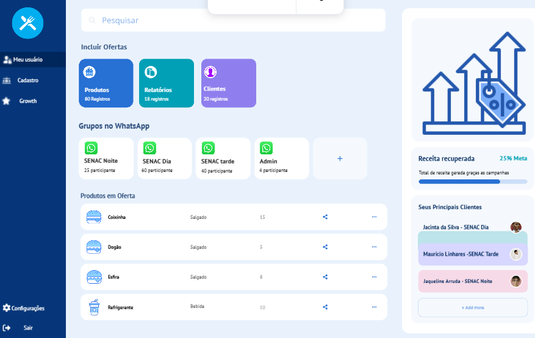
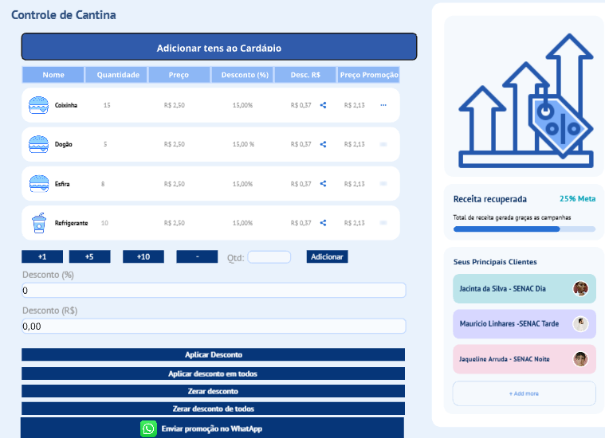
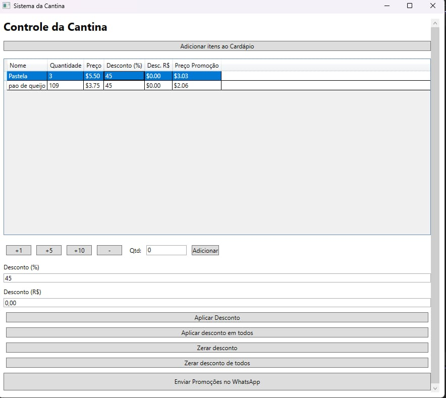
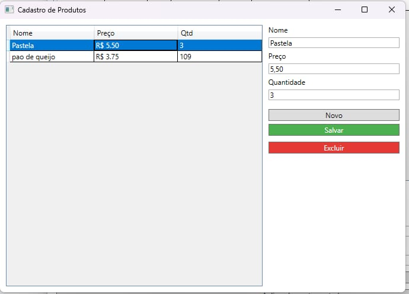
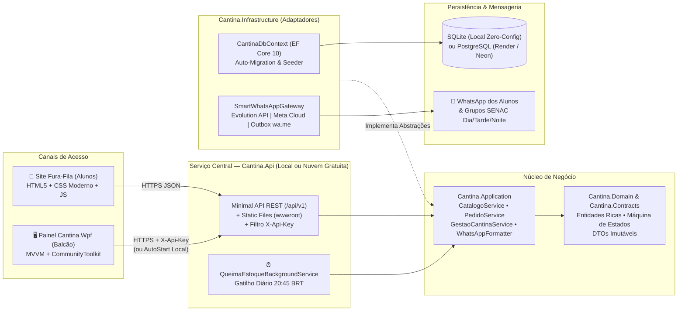
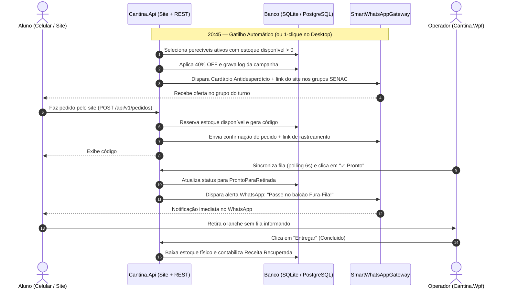
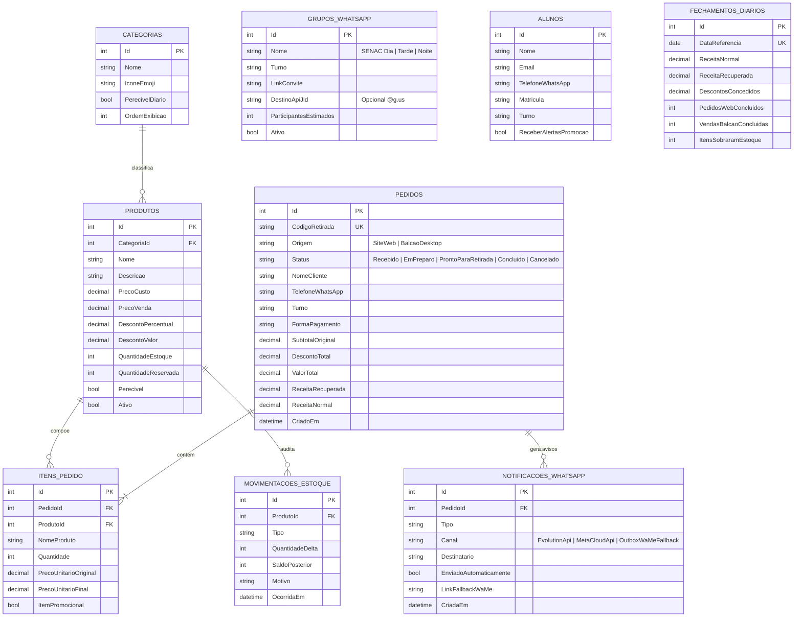

# DesperdícioZero — Ecossistema Web, Desktop & WhatsApp (Cantina ALAMO SENAC)

Plataforma completa em **.NET 10 (Clean Architecture)** para operação inteligente de cantinas escolares e universitárias. Combate o desperdício de alimentos perecíveis no fim do expediente e elimina filas nos intervalos conectando três pontas em tempo real:

1. **Site Web de Pedidos "Fura-Fila" (`Cantina.Api/wwwroot`):** vitrine responsiva onde alunos e funcionários consultam o cardápio ao vivo, aproveitam ofertas antidesperdício, fazem pedidos sem cadastro obrigatório e acompanham o status de preparo pelo código de retirada (`#AL-XXXX`).
2. **Painel Gerencial Desktop (`Cantina.Wpf`):** aplicativo Windows de balcão (inspirado no design *DesperdícioZero*) que gerencia o serviço local ou hospedado na nuvem, controla fila de pedidos, PDV rápido, estoque, promoções, fechamento diário e dispara a **Queima de Estoque das `20:45`**.
3. **Motor Multi-Canal de WhatsApp (`SmartWhatsAppGateway`):** envia confirmações de pedido, avisos de *"Seu lanche está pronto para retirada!"* e campanhas promocionais nos grupos de turno (**SENAC Dia**, **SENAC Tarde**, **SENAC Noite**) via **Evolution API** (open-source gratuito), **Meta WhatsApp Cloud API** ou **Outbox com links `wa.me` 1-clique**.

<p>
  
  
  
  
  
  
  
</p>

> ### 🌐 Acesso Rápido & Links da Aplicação
> - **Site Web Fura-Fila (Alunos):** [https://cantina-alamo-senac.onrender.com](https://cantina-alamo-senac.onrender.com)
> - **API REST & Cardápio Público (JSON):** [https://cantina-alamo-senac.onrender.com/api/v1/cardapio](https://cantina-alamo-senac.onrender.com/api/v1/cardapio)
> - **Monitoramento & Health Check:** [https://cantina-alamo-senac.onrender.com/health](https://cantina-alamo-senac.onrender.com/health)
> - **Instalador Desktop Admin + Auto-Update OTA:** [GitHub Releases (`CantinaAlamo-win-Setup.exe`)](https://github.com/Digooow/Projeto-Integrador-SENAC-JOINVILLE/releases)
> - **Guia Mestre do Front-End & Design System:** [`docs/FRONTEND_DESIGN_AND_ARCHITECTURE.md`](docs/FRONTEND_DESIGN_AND_ARCHITECTURE.md)
> - **Contrato Multi-Agente para IAs:** [`AGENTS.md`](AGENTS.md)
> - **Painel de Controle dos Serviços no Render:** [https://dashboard.render.com](https://dashboard.render.com)
> - **Repositório GitHub:** [https://github.com/Digooow/Projeto-Integrador-SENAC-JOINVILLE](https://github.com/Digooow/Projeto-Integrador-SENAC-JOINVILLE)
> - **Pipeline CI/CD (GitHub Actions):** [https://github.com/Digooow/Projeto-Integrador-SENAC-JOINVILLE/actions](https://github.com/Digooow/Projeto-Integrador-SENAC-JOINVILLE/actions)

---

## Sumário

- [Contexto e Proposta de Valor](#contexto-e-proposta-de-valor)
- [Requisitos Atendidos](#requisitos-atendidos)
- [Design Visual e Protótipos](#design-visual-e-protótipos)
- [Arquitetura do Ecossistema](#arquitetura-do-ecossistema)
- [Fluxo Operacional — Pedido Web, WhatsApp e Queima `20:45`](#fluxo-operacional--pedido-web-whatsapp-e-queima-2045)
- [Modelo de Dados (MER)](#modelo-de-dados-mer)
- [Referência da API REST](#referência-da-api-rest)
- [Como Executar Localmente](#como-executar-localmente)
- [Hospedagem 100% Gratuita na Nuvem + WhatsApp](#hospedagem-100-gratuita-na-nuvem--whatsapp)
- [Estrutura da Solução](#estrutura-da-solução)
- [Equipe e Contexto Acadêmico](#equipe-e-contexto-acadêmico)
- [Licença](#licença)

---

## Contexto e Proposta de Valor

Concebido a partir da operação real da **Cantina ALAMO** na **Faculdade de Tecnologia SENAC Joinville**, o sistema ataca duas dores diárias:

- **Desperdício de perecíveis no encerramento:** salgados assados, lanches naturais e doces do dia perdem valor comercial próximo ao fim do turno noturno. Às **`20:45`** (via `QueimaEstoqueBackgroundService` ou em 1 clique pelo operador), o sistema identifica automaticamente as sobras perecíveis sem exigir recontagem manual de bandejas, aplica desconto configurável e publica o **Cardápio Antidesperdício** no site e nos grupos de WhatsApp.
- **Filas nos intervalos de aula:** alunos pedem pelo celular em segundos, o estoque disponível já fica reservado com segurança transacional e o aluno recebe notificação no WhatsApp para passar direto na fila rápida de retirada.

---

## Requisitos Atendidos

| Código | Capacidade | Implementação |
|---|---|---|
| **RF01** | **Cardápio Online & Gestão de Produtos** | CRUD completo no WPF sincronizado em tempo real com a vitrine web (`GET /api/v1/cardapio`). |
| **RF02** | **Estoque com Reserva Transacional** | Separação entre `QuantidadeEstoque` (físico), `QuantidadeReservada` (pedidos ativos) e `QuantidadeDisponivel`, com trilha de auditoria (`MovimentacaoEstoque`). |
| **RF03** | **Motor de Descontos (`%` e `R$`)** | Descontos percentuais e em valor fixo (`R$`), individuais ou em lote, com trava contra preços negativos e inclusão integral na formatação do WhatsApp. |
| **RF04** | **Site de Pedidos Fura-Fila & Rastreamento** | Interface web moderna com carrinho, validação acessível (`:user-invalid`), `<dialog closedby="any">` e consulta ao vivo do status pelo código `#AL-XXXX`. |
| **RF05** | **Notificações & Campanhas no WhatsApp** | Alertas individuais (*Pedido Recebido*, *Em Preparo*, *Pronto para Retirada*, *Cancelado*) e campanhas nos grupos de turno (*SENAC Dia/Tarde/Noite*). |
| **RF06** | **Queima Automática às `20:45`** | Worker hospedado (`QueimaEstoqueBackgroundService`) operando no fuso `America/Sao_Paulo` + botão de disparo imediato no painel desktop. |
| **RF07** | **PDV de Balcão & Fechamento Diário** | Registro rápido de venda presencial e consolidação diária separando **Receita Normal** vs. **Receita Recuperada (Meta Antidesperdício)**. |

---

## Design Visual e Protótipos

### Conceito Visual *DesperdícioZero* (Implementado no Painel `Cantina.Wpf` e Vitrine Web)

| Dashboard *DesperdícioZero* e Grupos por Turno | Operação de Ofertas e Meta de Receita Recuperada |
|---|---|
|  |  |

### Histórico Visual — Primeira Versão Desktop Acadêmica

| Operação Inicial de Estoque e Descontos | Cadastro Inicial de Produtos |
|---|---|
|  |  |

---

## Arquitetura do Ecossistema

O projeto adota **Clean Architecture** com `TreatWarningsAsErrors=true`, desacoplando completamente o domínio das camadas de transporte HTTP, banco de dados, WhatsApp e interface desktop:



---

## Fluxo Operacional — Pedido Web, WhatsApp e Queima `20:45`



---

## Modelo de Dados (MER)



---

## Referência da API REST

### Endpoints Públicos (Site de Pedidos dos Alunos)

| Método | Rota | Descrição |
|---|---|---|
| `GET` | `/` | Interface web responsiva de pedidos e rastreamento Fura-Fila. |
| `GET` | `/health` | Health check para monitoramento e plataformas cloud. |
| `GET` | `/api/v1/cardapio` | Cardápio ativo, ofertas do momento, categorias e grupos de WhatsApp. |
| `POST` | `/api/v1/pedidos` | Cria pedido web, reserva estoque e aciona confirmação via WhatsApp. |
| `GET` | `/api/v1/pedidos/{codigo}` | Consulta status atualizado do pedido pelo código (ex.: `AL-7K9P`). |

### Endpoints do Backoffice (`/api/v1/gestao/*` — protegidos por `X-Api-Key` em produção)

| Método | Rota | Descrição |
|---|---|---|
| `GET` | `/api/v1/gestao/dashboard` | KPIs em tempo real, `% Meta Receita Recuperada`, ofertas e top clientes. |
| `GET / POST` | `/api/v1/gestao/produtos` | Lista todos os itens ou cadastra novo produto no cardápio. |
| `PUT / DELETE` | `/api/v1/gestao/produtos/{id}` | Atualiza dados do produto ou remove/inativa com segurança referencial. |
| `PATCH` | `/api/v1/gestao/produtos/{id}/estoque` | Reposição ou ajuste manual auditado de estoque. |
| `POST / DELETE` | `/api/v1/gestao/produtos/{id}/desconto` | Aplica ou remove promoção (`%` ou `R$`) em produto específico. |
| `POST / DELETE` | `/api/v1/gestao/produtos/descontos-lote` | Aplica ou encerra descontos em lote no catálogo. |
| `POST` | `/api/v1/gestao/queima-estoque` | Executa a Queima de Estoque (`20:45`) e dispara campanha no WhatsApp. |
| `GET` | `/api/v1/gestao/pedidos` | Fila ativa (`?apenasFila=true`) ou histórico completo de pedidos. |
| `POST` | `/api/v1/gestao/pedidos/venda-balcao` | Registra venda presencial rápida (PDV) com baixa imediata. |
| `PATCH` | `/api/v1/gestao/pedidos/{id}/status` | Avança status (`EmPreparo`, `ProntoParaRetirada`, `Concluido`, `Cancelado`) e notifica aluno. |
| `GET / POST / PUT` | `/api/v1/gestao/grupos-whatsapp` | Gerencia grupos de WhatsApp por turno e IDs `@g.us`. |
| `GET / POST / DELETE` | `/api/v1/gestao/alunos` | Cadastro opcional de alunos para avisos promocionais. |
| `GET` | `/api/v1/gestao/notificacoes-whatsapp` | Auditoria de mensagens enviadas e links `wa.me` 1-clique. |
| `GET` | `/api/v1/gestao/movimentacoes-estoque` | Histórico auditável de entradas, reservas, vendas e estornos. |
| `GET / POST` | `/api/v1/gestao/fechamentos` | Consolida e consulta fechamentos diários de caixa e antidesperdício. |

---

## Como Executar Localmente

### Pré-requisitos

- **.NET SDK 10.0+**
- **Windows 10/11** (para abrir o cliente desktop `Cantina.Wpf`; a API + Site rodam em Windows, Linux, macOS e Docker).

### Opção 1 — Experiência Integrada (Desktop + Site + Banco SQLite Automático)

Ao abrir o aplicativo Desktop no modo padrão (`AutoStartLocalServer: true`), ele verifica se o servidor local já está ativo e, caso não esteja, **sobe automaticamente o site e a API em `http://localhost:5180`** já populados com dados reais da Cantina ALAMO:

```powershell
dotnet run --project src/Cantina.Wpf/Cantina.Wpf.csproj
```

No próprio painel lateral do aplicativo, clique em **"🌐 Abrir Site de Pedidos"** (ou acesse http://localhost:5180 no navegador/celular na mesma rede) para simular um pedido como aluno e vê-lo entrar ao vivo na aba **"Fila Web & PDV"**!

### Opção 2 — Executar Apenas o Servidor Web + API (ou via Docker)

```powershell
# Direto via .NET CLI (SQLite zero-config)
dotnet run --project src/Cantina.Api/Cantina.Api.csproj --urls=http://localhost:5180

# Ou com PostgreSQL via Docker Compose
docker compose up --build -d
```

### Executar os Testes Automatizados

```powershell
dotnet build Projeto-Integrador-SENAC.slnx -c Release
dotnet test tests/Cantina.Tests/Cantina.Tests.csproj -c Release
```

---

## Hospedagem 100% Gratuita na Nuvem + WhatsApp

A arquitetura foi preparada para operar com **custo R\$ 0,00/mês**, permitindo que os alunos façam pedidos pela internet de qualquer lugar enquanto o computador da cantina gerencia tudo pelo aplicativo Desktop Windows.

### Passo 1 — Publicar o Site e a API Gratuitamente (Render.com Blueprint)

O repositório já inclui o arquivo `render.yaml` configurado com Docker + PostgreSQL gratuito:

1. Faça push deste repositório para o seu GitHub.
2. Crie uma conta gratuita em https://render.com e clique em **New + → Blueprint**.
3. Selecione o repositório `Projeto-Integrador-SENAC-JOINVILLE` e clique em **Apply**.
4. O Render criará automaticamente:
   - O banco PostgreSQL gratuito `cantina-alamo-db` (injetando `DATABASE_URL`).
   - O serviço web `https://cantina-alamo-senac.onrender.com` com HTTPS automático.
   - A chave secreta `Security__AdminApiKey` (copie o valor gerado na aba *Environment* do Render).

> **Alternativa gratuita sem hibernação de banco:** você também pode usar um banco PostgreSQL gratuito na **Neon.tech** ou **Supabase**, colando apenas a string `postgres://...` na variável `DATABASE_URL` no Render, Fly.io ou Koyeb.

### Passo 2 — Conectar o Aplicativo Desktop da Cantina à Nuvem

1. Abra o `Cantina.Wpf` no computador da cantina.
2. Acesse a aba **"☁️ Fechamento & Nuvem"**.
3. Em **URL Base da API & Site de Pedidos**, informe a URL pública (ex.: `https://cantina-alamo-senac.onrender.com`).
4. Em **Chave `X-Api-Key` do Backoffice**, cole a chave `Security__AdminApiKey` gerada no Render.
5. Clique em **"🔌 Salvar & Reconectar"**. Pronto: todos os pedidos feitos pelos alunos no site aparecerão instantaneamente no computador da cantina!

### Passo 3 — Escolher o Modo de Integração com WhatsApp

Configure as variáveis `WhatsApp__*` (veja `.env.example`):

| Modo (`WhatsApp__Provider`) | Custo | Como Funciona |
|---|---|---|
| **`Disabled` (Padrão Outbox + `wa.me`)** | **R\$ 0** | Zero configuração externa. Gera links `https://wa.me/5547...` prontos no site e no painel WPF para notificar o aluno em 1 clique no WhatsApp Web/Desktop. |
| **`EvolutionApi` (Recomendado para Grupos + Alunos)** | **R\$ 0** | Suba com `docker compose --profile whatsapp up -d`, escaneie o QR Code do WhatsApp da cantina e o servidor enviará mensagens **100% automáticas** tanto para o WhatsApp individual dos alunos quanto para os grupos de turno (`@g.us`) às `20:45`. |
| **`MetaCloudApi` (API Oficial Meta)** | **Cota gratuita Meta** | Usa o *WhatsApp Business Cloud API* oficial da Meta (`MetaPhoneNumberId` + `MetaAccessToken`) para envio automático individual em nuvem sem precisar manter celular conectado. |

---

### CI/CD e Deploy Automático no Render (Ao Fazer Commit)

**Sim, o projeto possui pipeline completo de CI/CD!** Você pode fazer commit e push que o site atualizará no Render automaticamente:

```text
[Seu Computador] ── git push origin main ──> [GitHub]
                                                │
                                                ├── 1. GitHub Actions (CI)
                                                │      • Compila toda a solução em Release
                                                │      • Executa os 15 testes unitários e de integração
                                                │
                                                └── 2. Render.com (CD Automático)
                                                       • Detecta o novo commit na branch 'main'
                                                       • Reconstrói o container Docker (Dockerfile)
                                                       • Publica a nova versão do site e da API sem downtime
```

1. **Continuous Integration (CI):**
   - Configurado em `.github/workflows/ci.yml`.
   - Executado automaticamente a cada push nas branches `main` e `develop`. Se algum teste falhar ou quebrar uma regra de negócio, o GitHub sinaliza com ❌ antes que vire um problema em produção.
2. **Continuous Deployment (CD no Render):**
   - No arquivo `render.yaml`, as diretivas `branch: main` e `autoDeploy: true` já estão configuradas.
   - Assim que você conecta o repositório no Render (via Blueprint), **toda alteração enviada para a branch `main` gera um deploy automático**. Não é necessário entrar no painel do Render para clicar em nada.
   - *(Opcional)*: Se quiser disparar o deploy explicitamente após os testes do GitHub Actions passarem, basta copiar o *Deploy Hook* do serviço no Render e salvá-lo como o secret `RENDER_DEPLOY_HOOK_URL` no GitHub (*Settings > Secrets and variables > Actions*).

---

## Estrutura da Solução

```text
Projeto-Integrador-SENAC/
├── .github/workflows/
│   ├── ci.yml                               # Pipeline CI compilando API, WPF e rodando xUnit
│   └── release-desktop.yml                  # Build automático do instalador Windows + Feed OTA (Velopack)
├── docs/
│   ├── FRONTEND_DESIGN_AND_ARCHITECTURE.md  # Guia Mestre: Design System "Alamo Fresh" + 4 Camadas Front-End
│   └── images/                              # Mockups DesperdícioZero e capturas de tela
├── scripts/
│   └── pack-installer.ps1                   # Gera o instalador CantinaAlamo-win-Setup.exe e pacote portátil
├── src/
│   ├── Cantina.Domain/                      # Entidades ricas, enums e invariantes de negócio
│   ├── Cantina.Contracts/                   # DTOs e contratos HTTP compartilhados (Web/API/WPF)
│   ├── Cantina.Application/                 # Casos de uso, formatador WhatsApp e abstrações
│   ├── Cantina.Infrastructure/              # EF Core 10 (SQLite + PostgreSQL), Seeder e SmartWhatsAppGateway
│   ├── Cantina.Api/                         # Minimal API REST, Worker 20:45 e Vitrine Web ativa servida via wwwroot/
│   ├── Cantina.Wpf/                         # Programa Desktop Instalável com Auto-Update OTA (AppUpdateService)
│   └── cantina-web/                         # Frontend modular em Angular 19+ (Core, State Signals, UI) em desenvolvimento/migração desacoplada
├── tests/
│   └── Cantina.Tests/                       # Testes unitários e de integração HTTP (WebApplicationFactory)
├── AGENTS.md                                # Contrato de engenharia para colaboração entre múltiplas IAs
├── .env.example                             # Modelo documentado de variáveis de ambiente
├── .gitignore                               # Padrão .NET + proteção de secrets, bancos locais e binários
├── Directory.Build.props                    # Padronização C# e TreatWarningsAsErrors=true
├── Dockerfile                               # Build multi-stage otimizado para nuvem gratuita
├── docker-compose.yml                       # PostgreSQL + Cantina.Api + Evolution API opcional
├── Projeto-Integrador-SENAC.slnx            # Solução .NET 10 multi-projetos
├── render.yaml                              # Blueprint 1-clique para hospedagem gratuita no Render.com
└── README.md
```

---

## Equipe e Contexto Acadêmico

Projeto Integrador concebido no **Programa Jovem Programador — Desenvolvedor de Sistemas** da **Faculdade de Tecnologia SENAC Joinville** e evoluído para arquitetura completa de produção:

- **Alan Alexis Marin Benitez** — Modelagem e Banco de Dados
- **Matheus Souza** — Documentação e Requisitos
- **Maurício de Souza Sant'anna** — Coordenação de Equipe e Apresentação
- **Rodrigo da Cruz Godinho** — Arquitetura Clean, API Web, Integração WhatsApp e Painel WPF
- **Orientação:** Prof. Marcelo

---

## Licença

Distribuído sob a licença MIT.
