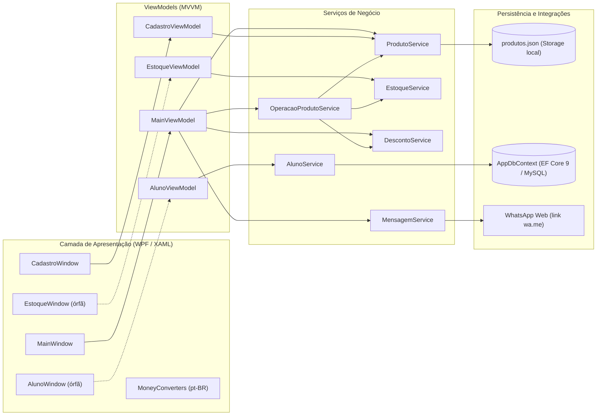
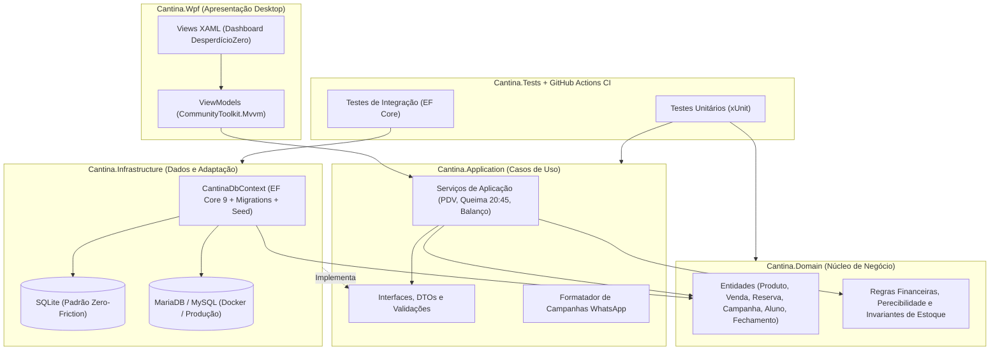
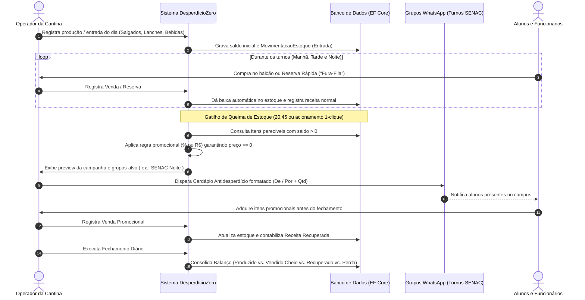
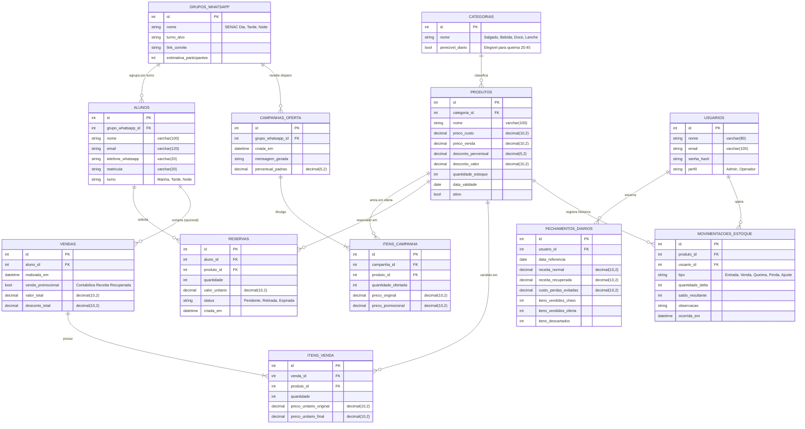

# DesperdícioZero — Sistema da Cantina (Cardápio Antidesperdício)

Aplicação desktop em **C# / WPF (.NET 10)** concebida para apoiar a operação diária de cantinas escolares e pequenos comércios alimentícios, combatendo o desperdício de alimentos perecíveis ao final do expediente por meio de controle em tempo real de estoque, **queima de estoque automatizada** e divulgação ágil de ofertas por turno via WhatsApp.

> **Status atual:** protótipo funcional acadêmico em evolução para arquitetura limpa de portfólio. O build atual é 100% compilável e executável no Windows, com histórico Git higienizado e documentação arquitetural consolidada em código.

<p>
  
  
  
  
  
</p>

---

## Sumário

- [Contexto e Problema de Negócio](#contexto-e-problema-de-negócio)
- [Requisitos do Sistema](#requisitos-do-sistema)
- [Telas e Design Visual](#telas-e-design-visual)
- [Arquitetura do Sistema](#arquitetura-do-sistema)
- [Fluxo Operacional — Queima de Estoque (`20:45`)](#fluxo-operacional--queima-de-estoque-2045)
- [Modelo de Dados (MER)](#modelo-de-dados-mer)
- [Estado Atual e Diagnóstico Técnico](#estado-atual-e-diagnóstico-técnico)
- [Stack Tecnológica](#stack-tecnológica)
- [Como Executar](#como-executar)
- [Estrutura do Repositório](#estrutura-do-repositório)
- [Roadmap de Engenharia](#roadmap-de-engenharia)
- [Equipe e Contexto Acadêmico](#equipe-e-contexto-acadêmico)
- [Licença](#licença)

---

## Contexto e Problema de Negócio

O projeto nasceu a partir da observação real da rotina da **Cantina ALAMO** na **Faculdade de Tecnologia SENAC Joinville**, identificando duas dores operacionais diretas:

1. **Desperdício no fim do expediente:** Salgados, assados e lanches preparados para o dia que permanecem sem venda próximo ao fechamento noturno perdem valor comercial e acabam descartados.
2. **Atrito de filas nos intervalos:** Durante os horários de pico entre aulas, muitos alunos e funcionários desistem da compra para não aguardar vários minutos na fila.

**Proposta de valor (*"Não vendeu, não desperdice — Localizamos os consumidores"*):**
- Manter o saldo dos produtos atualizado conforme as baixas ocorrem ao longo dos turnos.
- Próximo ao encerramento (ex.: **`20:45`**), identificar automaticamente os itens remanescentes — sem exigir contagem manual de bandejas pelos atendentes —, aplicar regras de desconto (`%` ou `R$`) e divulgar o **Cardápio Antidesperdício** nos grupos de WhatsApp de cada turno (**SENAC Dia**, **SENAC Tarde**, **SENAC Noite**), maximizando a **Receita Recuperada** e reduzindo perdas.

---

## Requisitos do Sistema

Requisitos consolidados a partir da especificação original do Projeto Integrador:

### Requisitos Funcionais

| Código | Requisito | Status |
|---|---|---|
| **RF01** | **Gestão de Cardápio:** cadastrar, editar, buscar e excluir produtos com preço e quantidade disponível. | Implementado |
| **RF02** | **Controle de Estoque:** realizar ajustes rápidos (`+1`, `+5`, `+10`, `-1` e lote customizado) e baixas por venda. | Parcial (ajustes prontos; venda desacoplada) |
| **RF03** | **Motor de Descontos:** aplicar e remover descontos percentuais (`%`) ou em valor fixo (`R$`), por item ou em lote. | Implementado |
| **RF04** | **Divulgação via WhatsApp:** gerar mensagem promocional com preços *"De / Por"* dos itens disponíveis em oferta. | Parcial (`wa.me` manual; segmentação por grupo prevista) |
| **RF05** | **Gestão Opcional de Alunos/Clientes:** cadastrar alunos interessados sem tornar o cadastro obrigatório para participar dos grupos de oferta. | Parcial (CRUD EF Core criado; tela desconectada) |
| **RF06** | **Queima de Estoque Automática (`20:45`):** acionar automaticamente as ofertas de fim de dia com base no saldo remanescente. | Planejado |
| **RF07** | **Reserva Rápida ("Fura-Fila") & Balanço Diário:** permitir reserva antecipada para retirada no balcão e relatório de vendido vs. sobra / receita recuperada. | Planejado |

### Requisitos Não Funcionais

| Código | Requisito | Diretriz |
|---|---|---|
| **RNF01** | **Baixo Atrito Operacional** | O atendente da cantina não deve precisar recontar estoque manualmente para disparar a queima de fim de dia. |
| **RNF02** | **Adoção sem Burocracia** | Alunos podem receber ofertas pelos grupos de turno no WhatsApp mesmo sem cadastro prévio individual. |
| **RNF03** | **Integridade Transacional** | Estoque nunca pode ficar negativo; descontos nunca podem gerar preço promocional menor que zero. |
| **RNF04** | **Execução Local Zero-Friction** | A aplicação deve rodar imediatamente em ambiente local de avaliação/desenvolvimento, com opção de banco relacional dedicado. |
| **RNF05** | **Testabilidade e Manutenibilidade** | Regras de negócio desacopladas da interface WPF, cobertas por testes automatizados e validação em CI. |

---

## Telas e Design Visual

### 1. Protótipo Funcional Atual (WPF em Execução)

| Operação Principal e Descontos (`MainWindow`) | Cadastro e Busca de Produtos (`CadastroWindow`) |
|---|---|
|  |  |

### 2. Design Conceitual — Interface Alvo (*DesperdícioZero*)

Evolução visual projetada pela equipe para unificar os indicadores de **Receita Recuperada**, grupos de WhatsApp por turno (**SENAC Dia / Tarde / Noite**) e gestão rápida de ofertas em um único Dashboard moderno:

| Dashboard *DesperdícioZero* e Grupos por Turno | Operação de Ofertas e Meta de Receita Recuperada |
|---|---|
|  |  |

---

## Arquitetura do Sistema

### Arquitetura Atual (Protótipo MVVM)



### Arquitetura Alvo (Padrão *Clean Architecture* Multi-Projetos)



---

## Fluxo Operacional — Queima de Estoque (`20:45`)

O diagrama abaixo detalha o ciclo operacional diário que conecta produção, baixas por venda/reserva e disparo antidesperdício próximo ao encerramento:



---

## Modelo de Dados (MER)

Modelo Entidade-Relacionamento consolidado, evoluindo o diagrama original do MySQL Workbench para suportar persistência unificada, rastreabilidade de estoque, reservas, grupos de WhatsApp por turno e cálculo de receita recuperada:



---

## Estado Atual e Diagnóstico Técnico

### Evidências do Build Atual

| Verificação | Status Atual |
|---|---|
| Target Framework | `net10.0-windows` (WPF habilitado) |
| Compilação (`dotnet build`) | Sucesso (`0` erros) |
| Persistência de Produtos | Arquivo local `produtos.json` (`Services/Storage.cs`) |
| Persistência de Alunos | MariaDB/MySQL via EF Core 9 (`Data/AppDbContext.cs`) |
| Integração WhatsApp | Abertura de URL `https://wa.me/?text=...` com mensagem codificada |
| Higiene de Versionamento | Histórico Git limpo (sem `bin/`, `obj/`, `.vs/`, `*.user` ou binários Office) |

### Pontos Técnicos Mapeados para Refatoração (Próxima Fase)

1. **Unificação da Persistência:** Migrar `ProdutoService` do `produtos.json` para o EF Core, adotando **SQLite por padrão** (execução imediata sem servidor externo) e mantendo compatibilidade configurável com **MariaDB/MySQL**.
2. **Conexão das Telas Órfãs e Novo Dashboard:** Integrar os fluxos de `AlunoWindow` e `EstoqueWindow` (registro de vendas) dentro do novo Dashboard inspirado no conceito visual *DesperdícioZero*.
3. **Correção do Filtro de Promoções no WhatsApp:** Em `MensagemService`, incluir produtos com desconto fixo em reais (`DescontoValor > 0`, e não apenas `Desconto > 0`) e formatar valores com moeda `pt-BR` (`C2`).
4. **Injeção de Dependência e MVVM Puro:** Remover instanciações diretas (`new DescontoService()`, `new CadastroWindow(...)`, `MessageBox.Show`) de dentro das ViewModels, corrigir registros duplicados em `App.xaml.cs` e externalizar strings de conexão em `appsettings.json`.
5. **Suíte de Testes e CI:** Adicionar projetos `xUnit` cobrindo regras de desconto, estoque, queima das `20:45`, formatação de mensagens e persistência EF Core, executados via GitHub Actions.

---

## Stack Tecnológica

| Camada | Tecnologia Atual | Evolução Planejada |
|---|---|---|
| **Runtime & Linguagem** | C# / .NET 10 | C# 14 / .NET 10 com Nullable & Analyzers estritos |
| **Interface Desktop** | WPF / XAML + MVVM manual | WPF moderno (tema *DesperdícioZero*) + `CommunityToolkit.Mvvm` |
| **Injeção de Dependência** | `Microsoft.Extensions.DependencyInjection` | `Microsoft.Extensions.Hosting` + `appsettings.json` |
| **ORM & Banco de Dados** | EF Core 9 + Pomelo MySQL + `System.Text.Json` | EF Core 9 unificado (SQLite padrão + MariaDB/MySQL via Docker) |
| **Qualidade & CI/CD** | Validação manual | `xUnit`, `FluentAssertions`, testes de integração e GitHub Actions |

---

## Como Executar

### Pré-requisitos

- **Windows 10/11**
- **.NET SDK 10.0** ou superior
- *(Opcional no estado atual)* MariaDB/MySQL local caso deseje testar o repositório `AlunoService` via EF Core

### Passo a Passo

```powershell
# 1. Restaurar pacotes e compilar a solução
dotnet restore
dotnet build

# 2. Executar a aplicação WPF
dotnet run
```

> **Nota sobre banco de dados no estado atual:** A tela principal de produtos e descontos funciona imediatamente utilizando `produtos.json` gerado em tempo de execução (ignorado pelo Git). Para aplicar a migration inicial no MariaDB/MySQL local (`ProjetoIntegradorSENAC`):
> ```powershell
> dotnet ef database update
> ```

---

## Estrutura do Repositório

```text
Projeto-Integrador-SENAC/
├── Converters/                  # Conversores monetários (estilo maquininha pt-BR)
├── Data/                        # AppDbContext e fábrica design-time do EF Core
├── Migrations/                  # Migrações do banco de dados
├── Models/                      # Entidades Produto e Aluno
├── Services/                    # Regras de produtos, estoque, descontos e WhatsApp
├── ViewModels/                  # Estado das telas, bindings e RelayCommand
├── Views/                       # Janelas XAML (MainWindow, Cadastro, Estoque, Aluno)
├── docs/
│   └── images/                  # Screenshots reais da aplicação e mockups de UI
├── .gitignore                   # Padrão oficial .NET + regras para .env, DBs e Office
├── App.xaml / App.xaml.cs       # Bootstrap da aplicação, cultura pt-BR e container DI
├── Projeto-Integrador-SENAC.csproj
├── Projeto-Integrador-SENAC.slnx
└── README.md
```

---

## Roadmap de Engenharia

- [x] **Fase 1 — Higiene de Repositório & Documentação Viva:** limpeza completa do histórico Git, `.gitignore` oficial de C#/.NET, diagramas arquiteturais/MER em Mermaid e galeria visual em `docs/images/`.
- [ ] **Fase 2 — Clean Architecture & Persistência Unificada:** separação em `Domain`, `Application`, `Infrastructure` e `Wpf`, eliminando o `produtos.json` em favor de EF Core com SQLite (*zero-friction*) + suporte a MariaDB/Docker.
- [ ] **Fase 3 — Domínio Completo (*DesperdícioZero*):** vendas/PDV, reservas rápidas, motor automático de queima às `20:45`, grupos de WhatsApp por turno e balanço diário de receita recuperada.
- [ ] **Fase 4 — Interface Moderna WPF:** implementação do Dashboard *DesperdícioZero* unificando todas as telas e indicadores.
- [ ] **Fase 5 — Testes Automatizados & CI:** suíte de testes unitários e de integração (`xUnit`) + workflow de integração contínua no GitHub Actions.

---

## Equipe e Contexto Acadêmico

Projeto Integrador desenvolvido no **Programa Jovem Programador — Desenvolvedor de Sistemas** da **Faculdade de Tecnologia SENAC Joinville**:

- **Alan Alexis Marin Benitez** — Modelagem e Banco de Dados
- **Matheus Souza** — Documentação e Requisitos
- **Maurício de Souza Sant'anna** — Coordenação de Equipe e Apresentação
- **Rodrigo da Cruz Godinho** — Arquitetura, Interface WPF e Evolução de Engenharia
- **Orientação:** Prof. Marcelo

---

## Licença

Distribuído sob a licença MIT.
