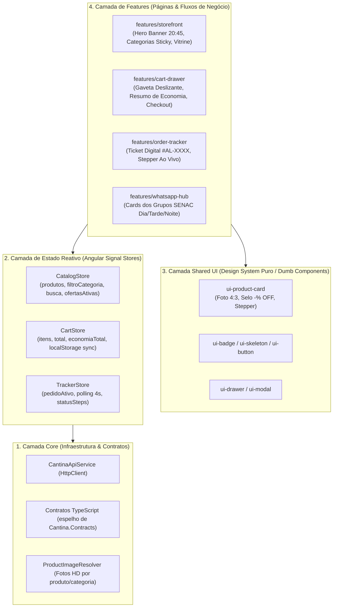
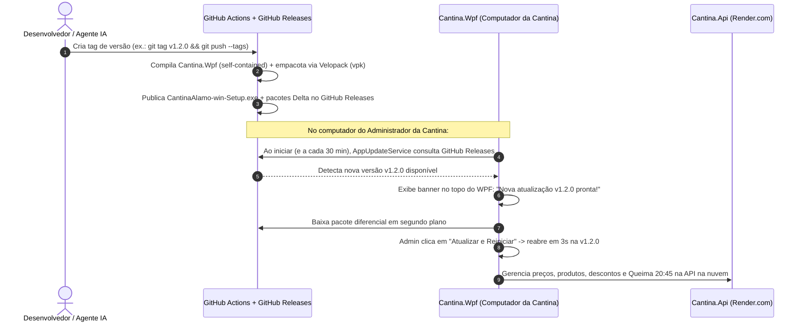

# Guia Mestre de Arquitetura: Frontend Web (Angular), Design System & Desktop Instalável com Auto-Update

> **Objetivo deste documento:** Servir como especificação técnica e visual definitiva ("Single Source of Truth") para o desenvolvimento da nova interface web dos alunos, a evolução do aplicativo instalável dos administradores e a colaboração coordenada entre desenvolvedores humanos e múltiplos agentes de IA.

---

## 1. Diagnóstico do Frontend Atual & Recomendações de Engenharia

### 1.1 Por que o site atual em `wwwroot/` ficou feio e bagunçado?

1. **Uso de emojis no lugar de fotografia gastronômica real:** Aplicativos reais de alimentação (*iFood*, *Rappi*, *Sweetgreen*, *Too Good To Go*) despertam apetite por meio de **fotos reais, bem iluminadas e com proporção padronizada (`4:3` ou `1:1`)**. Emojis de sistema operacional (`🥐`, `🍗`, `🥤`) fazem qualquer layout parecer um trabalho escolar, independentemente do CSS.
2. **Ausência de uma biblioteca de ícones vetoriais consistente:** Misturar emojis no texto de botões (`🔎`, `🛍️`, `🔥`) quebra o alinhamento vertical e muda de aparência entre Windows, Android e iOS. O padrão de mercado é utilizar ícones SVG vetoriais de traço uniforme (**Lucide Icons**).
3. **Paleta fria de "painel corporativo":** Fundos cinza-azulados (`#f0f4f9`) e azul-marinho pesado funcionam para o *Backoffice Desktop*, mas para um cardápio de comida passam sensação hospitalar/fria. Comida pede **tons neutros quentes** (*Warm Stone / Off-White Creme* `#FAF8F5`), **laranja fornada / terracota** (`#EA580C`) e **verde fresco** (`#059669`) para o selo antidesperdício.
4. **Código acoplado em 3 arquivos monolíticos (`index.html`, `styles.css`, `app.js`):**
   - Manipulação imperativa de DOM (`document.createElement` repetido dezenas de vezes) misturada com chamadas `fetch()`, regras de cálculo de desconto e controle de timers.
   - Qualquer mudança em um card exige editar HTML montado via string/DOM dentro do JavaScript e caçar classes globais em um único `styles.css`.

### 1.2 Recomendações de Stack Frontend

Para resolver de vez tanto a **beleza visual** quanto a **organização em camadas**, recomendamos a seguinte stack principal (com uma alternativa caso queira usar geradores visuais externos):

| Critério | **Stack Principal (Escolhida): Angular 19+ Moderno** | **Alternativa Visual Rápida: React 19 + Vite + shadcn/ui** |
|---|---|---|
| **Arquitetura e Camadas** | **Excelente.** *Standalone Components*, Injeção de Dependência nativa (`inject()`), *Signals* (`signal`, `computed`) e separação rígida entre *Core*, *Shared UI* e *Features*. Conversa perfeitamente com a mentalidade C# / .NET. | Muito boa se organizada com *Feature-Sliced Design* + Zustand/TanStack Query. |
| **Estilização & UI** | **Tailwind CSS v4 + Lucide Angular + Angular CDK (Dialogs/Drawers acessíveis)** + animações fluidas. | **Tailwind CSS + shadcn/ui** (permite copiar telas prontas geradas no `v0.dev`). |
| **Integração com `Cantina.Api`** | Compilado em build estático (`ng build`) e servido pelo próprio container da API no Render.com (custo R\$ 0/mês) ou em CDN gratuita. | Mesmo modelo de build estático. |

> **Decisão Arquitetural:** Seguiremos com **Angular 19+ (Standalone + Signals + Tailwind CSS + Lucide Icons)** em `src/cantina-web/`, mantendo uma separação de camadas tão limpa que qualquer agente de IA consegue criar ou alterar um componente visual sem tocar na lógica de negócio.

---

## 2. Identidade Visual & Design System — *"Alamo Fresh & ZeroWaste"*

### 2.1 Conceito e Referências Visuais

- **Assinatura Visual:** *Artesanal, Quente, Rápido e Sustentável*.
- **Referências de Design:**
  - **iFood / Uber Eats (2025/2026):** Cards de produto horizontais no mobile e verticais no desktop, foto ocupando área nobre com zoom suave, gaveta lateral (*Slide-over Cart Drawer*) e barra de categorias *sticky*.
  - **Too Good To Go (App Europeu Antidesperdício):** Selos de impacto ambiental ("🌱 Salve este lanche • -40% OFF"), contagem regressiva para a janela de coleta/queima das `20:45`.

### 2.2 Regras Visuais Inegociáveis (Zero-Emoji Policy)

1. **PROIBIDO usar emojis como foto de produto:** Todo produto possui uma URL de imagem real (`imagemUrl`) ou um mapeamento inteligente por nome/categoria para fotografias reais de alta resolução (ex.: coxinha dourada crocante, croissant folhado, pastel assado, hambúrguer artesanal, suco natural com gelo, brownie com calda).
2. **PROIBIDO usar emojis soltos em botões de ação:** Todos os ícones de interface (busca, sacola, relógio, chama, WhatsApp, check, fechar, mais/menos) devem usar **Lucide Icons SVG** (`stroke-width: 2px`).
3. **Números Tabulares em Preços e Contadores:** Toda exibição de preço (`R$ 5,40`) e cronômetro (`20:45`) deve aplicar `font-variant-numeric: tabular-nums` para evitar trepidação de layout durante atualizações em tempo real.

### 2.3 Paleta de Cores Semântica (Design Tokens)

| Token CSS / Tailwind | Hexadecimal | Função na Interface |
|---|---|---|
| `--bg-canvas` (`bg-stone-50`) | `#FAF8F5` | Fundo principal da página (creme suave que destaca cards brancos). |
| `--bg-surface` (`bg-white`) | `#FFFFFF` | Superfície de cards, gaveta do carrinho e modais. |
| `--bg-glass` | `rgba(255, 255, 255, 0.86)` | Header fixo e cápsula flutuante com `backdrop-filter: blur(16px)`. |
| `--text-primary` (`text-stone-900`) | `#1C1917` | Títulos de produtos, preços finais e cabeçalhos. |
| `--text-secondary` (`text-stone-500`) | `#78716C` | Descrições de ingredientes, subtítulos e dicas de formulário. |
| `--brand-primary` (`orange-600`) | `#EA580C` | Cor gastronômica primária: botões de compra ("Adicionar"), pílula ativa e destaques da Cantina ALAMO. |
| `--brand-primary-soft` (`orange-50`) | `#FFF7ED` | Fundo de badges quentes e hover suave de categorias. |
| `--zerowaste-green` (`emerald-600`) | `#059669` | Selo **DesperdícioZero**, preço promocional da queima das `20:45` e economia gerada na sacola. |
| `--zerowaste-soft` (`emerald-50`) | `#ECFDF5` | Fundo do banner de economia antidesperdício e chips do WhatsApp. |
| `--status-warning` (`amber-600`) | `#D97706` | Alerta de "Últimas 3 unidades no balcão!". |
| `--status-danger` (`red-600`) | `#DC2626` | Produto esgotado ou erro de validação. |

### 2.4 Tipografia

- **Família Principal (Títulos, Preços e Botões):** `'Plus Jakarta Sans'`, sans-serif (Pesos `600`, `700`, `800`).
- **Família Secundária (Corpo, Descrições e Inputs):** `'Inter'`, sans-serif (Pesos `400`, `500`, `600`).
- **Escala Tipográfica:**
  - *Hero Display:* `clamp(1.75rem, 3vw, 2.5rem)`, `font-weight: 800`, `letter-spacing: -0.03em`.
  - *Section Heading:* `1.35rem` (`21.6px`), `font-weight: 700`.
  - *Product Title:* `1.05rem` (`16.8px`), `font-weight: 700`, `line-height: 1.3`.
  - *Product Price Final:* `1.25rem` (`20px`), `font-weight: 800`, `tabular-nums`.

---

## 3. Arquitetura em Camadas do Frontend (`src/cantina-web/`)

Para acabar com a bagunça de código misturado, o aplicativo Angular segue uma arquitetura em **4 camadas estritas** com fluxo de dados unidirecional:



### 3.1 Estrutura de Diretórios Planejada (`src/cantina-web/`)

```text
src/cantina-web/
├── public/
│   └── assets/images/               # Fallbacks locais e ícones da marca
├── src/
│   ├── app/
│   │   ├── core/                    # CAMADA 1: Infraestrutura, API e Modelos
│   │   │   ├── api/
│   │   │   │   └── cantina-api.service.ts
│   │   │   ├── models/
│   │   │   │   └── cantina.models.ts
│   │   │   └── utils/
│   │   │       └── product-image.resolver.ts
│   │   │
│   │   ├── state/                   # CAMADA 2: Signal Stores (Estado Global Reativo)
│   │   │   ├── catalog.store.ts
│   │   │   ├── cart.store.ts
│   │   │   └── order-tracker.store.ts
│   │   │
│   │   ├── shared/                  # CAMADA 3: Design System (Componentes Visuais Puros)
│   │   │   └── ui/
│   │   │       ├── navbar/
│   │   │       ├── product-card/
│   │   │       ├── category-bar/
│   │   │       ├── quantity-stepper/
│   │   │       └── skeleton-card/
│   │   │
│   │   ├── features/                # CAMADA 4: Funcionalidades de Negócio
│   │   │   ├── storefront/          # Página principal + Hero Queima 20:45 + Grid
│   │   │   ├── cart-drawer/         # Sacola lateral deslizante + Checkout em 2 passos
│   │   │   ├── order-tracker/       # Modal/Drawer de rastreamento em tempo real
│   │   │   └── whatsapp-banner/     # Seção dos grupos de turno do SENAC
│   │   │
│   │   ├── app.component.ts
│   │   ├── app.config.ts
│   │   └── app.routes.ts
│   ├── index.html
│   └── styles.css                   # Tokens Tailwind + variáveis do Design System
├── angular.json
├── package.json
└── tsconfig.json
```

### 3.2 Regras das Camadas do Frontend

1. **Componentes em `shared/ui/` são 100% "Dumb" (Apresentacionais):**
   - Recebem dados apenas via `input()` e emitem eventos via `output()`.
   - **Nunca** injetam `HttpClient` nem conhecem regras de API. Isso permite redesenhar qualquer componente visual sem risco de quebrar o funcionamento do pedido.
2. **Toda regra de estado fica nos `Signal Stores` (`state/`):**
   - `CatalogStore`: mantém a lista de produtos, aplica o resolvedor de fotos reais (`ProductImageResolver`), expõe `computed()` para categorias, contagem de ofertas e produtos filtrados, e faz *polling* silencioso a cada 10s sem piscar a tela (sem recriar o DOM inteiro!).
   - `CartStore`: gerencia os itens adicionados, sincroniza com `localStorage`, impede adicionar além do estoque disponível e calcula subtotal, desconto antidesperdício e total final via `computed()`.
   - `OrderTrackerStore`: gerencia o acompanhamento ao vivo do pedido `#AL-XXXX`.
3. **Integração Transparente com o Backend C# (`Cantina.Api`):**
   - Em desenvolvimento: `ng serve` usa proxy para `http://localhost:5180/api/v1`.
   - Em produção (`Dockerfile` / Render.com): o estágio Node do `Dockerfile` executa `npm run build` e copia o bundle otimizado (`dist/cantina-web/browser`) diretamente para o `wwwroot/` da `Cantina.Api`. Assim, você continua tendo **um único deploy gratuito no Render.com** servindo tanto o Angular quanto a API C#!

---

## 4. Arquitetura do Programa Instalável no Computador + Auto-Update (`Cantina.Wpf`)

Para atender ao requisito: *"preciso de um programa que possa ser instalado no computador para que os administradores possam gerenciar os preços e produtos, e que esse programa possa receber atualizações"*, a arquitetura do cliente Desktop é dividida em **Empacotamento Instalável** e **Motor de Atualização Automática OTA (Over-The-Air)**.

### 4.1 Tecnologia Escolhida: **Velopack** + **GitHub Releases**

O **Velopack** é o framework moderno padrão para aplicações `.NET 8/9/10` no Windows (sucessor do antigo Squirrel.Windows e muito superior ao ClickOnce, que não suporta bem recursos modernos do .NET 10):

- **Instalador em 1 Clique (`CantinaAlamo-win-Setup.exe`):** O administrador da cantina baixa um único `.exe`, dá dois cliques e o programa é instalado em `%LocalAppData%\CantinaAlamo` (sem exigir senha de Administrador do Windows!), criando automaticamente os atalhos na **Área de Trabalho** e no **Menu Iniciar**.
- **Atualizações Diferenciais (Delta Updates):** Quando uma nova versão é lançada, o programa da cantina baixa apenas os kilobytes que mudaram, aplica a atualização em segundo plano e reinicia já atualizado em menos de 3 segundos.
- **Hospedagem de Atualizações 100% Gratuita:** O próprio **GitHub Releases** do repositório (`Digooow/Projeto-Integrador-SENAC-JOINVILLE`) funciona como servidor de atualizações gratuito via `GithubSource` do Velopack!

### 4.2 Fluxo Arquitetural de Instalação e Auto-Update



### 4.3 Camadas Internas do `Cantina.Wpf` para Suportar Auto-Update

- `VelopackApp.Build().Run()` no ponto de entrada (`App.xaml.cs` / `Program`) para gerenciar eventos de instalação, criação de atalhos e desinstalação limpa.
- `Services/AppUpdateService.cs`: serviço encapsulado que verifica atualizações no repositório GitHub (ou URL customizada configurável em `appsettings.wpf.json`), expõe a versão instalada atual (`VersaoAtual`), se há nova versão disponível (`AtualizacaoDisponivel`) e o comando `BaixarEAplicarAtualizacaoAsync()`.
- Workflow `.github/workflows/release-desktop.yml`: pipeline automatizado que gera e publica o instalador `CantinaAlamo-win-Setup.exe` sempre que uma tag `v*` é enviada ou quando disparado manualmente (*workflow_dispatch*).

---

## 5. Plano de Execução Passo a Passo (Ordem de Construção)

Para que o desenvolvimento ocorra de forma previsível e modular (inclusive dividindo tarefas entre diferentes IAs):

1. **Fase A — Guia Arquitetural & Orquestração Multi-Agente (Concluída neste documento + `AGENTS.md`):**
   - Documentar Design System, camadas do Angular, arquitetura do instalador Velopack e regras de colaboração entre agentes.
2. **Fase B — Construção do Novo Frontend Angular (`src/cantina-web/`):**
   - Inicializar o projeto Angular 19+ com Tailwind CSS e Lucide Icons.
   - Implementar a **Camada Core** (`cantina-api.service.ts`, modelos tipados e `product-image.resolver.ts` com fotos reais gastronômicas).
   - Implementar a **Camada State** (`CatalogStore`, `CartStore`, `OrderTrackerStore` com Signals).
   - Implementar a **Camada Shared UI** e **Features** (Header Glass, Hero da Queima `20:45`, Categorias Sticky, Cards com fotos reais, Gaveta de Checkout e Rastreador estilo bilhete).
   - Integrar o build do Angular ao `Cantina.Api` e ao `Dockerfile` multi-stage para deploy automático no Render.
3. **Fase C — Programa Instalável com Auto-Update (`Cantina.Wpf` + Velopack):**
   - Integrar o SDK `Velopack` no `Cantina.Wpf`.
   - Criar o `AppUpdateService` e adicionar o indicador de versão + botão **"Verificar / Aplicar Atualização"** na barra superior do painel administrativo WPF.
   - Criar o script local `scripts/pack-installer.ps1` e o workflow `.github/workflows/release-desktop.yml` que gera o instalador `CantinaAlamo-win-Setup.exe` e publica atualizações automáticas no GitHub Releases.

